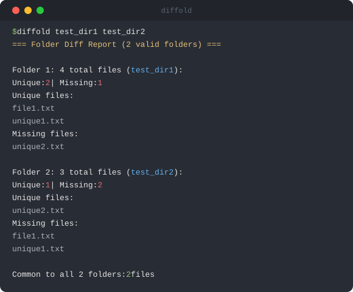

<div align="center">


# diffold

Compare 2–5 directories and see which files are unique, missing, and common across them.

[](https://www.npmjs.com/package/diffold)
[](https://www.npmjs.com/package/diffold)
[](https://www.npmjs.com/package/diffold)
[](./LICENSE)
[](https://nodejs.org/)
[](https://github.com/drizzer/diffold/actions/workflows/checks.yml)
[](./package.json)



[](https://github.com/sponsors/drizzer)

</div>

`diffold` is a small dependency-free TypeScript CLI. The published package ships compiled JavaScript for package runners, so end users can run it directly with `npx` or `bunx`.

## Quick Start

```bash
# Run without installing
npx diffold dir1 dir2
bunx diffold dir1 dir2

# Or install globally with npm
npm install -g diffold
diffold dir1 dir2 dir3
```

## Features

- Multi-directory comparison for 2–5 directories
- Content-aware comparison with streaming SHA-256 hashing (disable with `-c`)
- `--quick` size/mtime comparison for trees too large to hash (approximate)
- Versioned JSON output for CI, scripts, and piping to tools such as `jq`
- Repeatable glob exclusions for files, directory names, and subtrees
- Summary-first output that stays readable on large trees, with `--verbose` and `--quiet`
- Report file output with `-f`, extension inference, and overwrite protection
- CI-friendly exit codes with an opt-in `--fail-on-diff` gate
- Matrix presence table by default (`--matrix`/`-m`), with `--list`/`-l` for per-folder lists; rows where every folder agrees are hidden unless `--verbose`
- Color-coded terminal output that stays plain when redirected or told to
  (`--no-color`, `NO_COLOR`); report files never contain escape sequences
- Unique, missing, and common file counts
- Recursive directory traversal
- `~` home-directory expansion
- Windows drive and slash normalization
- Guarded traversal (depth and file-count limits)
- Terminal-safe output (ANSI/control-sequence sanitization)
- `--help` and `--version` for self-documenting, script-friendly runs
- Runtime source compatibility with Node.js and Bun

## Usage

```bash
diffold <dir1> <dir2> [... <dirN>] [options]
```

Options:

| Option | Effect |
|--------|--------|
| `-c`, `--no-content` | Compare paths only. Content comparison is enabled by default. |
| `--quick` | Compare size and mtime instead of hashing common files (approximate). |
| `--json` | Print a machine-readable JSON report to stdout. |
| `-e`, `--exclude <glob>` | Exclude matching files/directories; repeat for multiple patterns. |
| `-v`, `--verbose` | Print every entry instead of truncating long lists. |
| `-q`, `--quiet` | Print only summary counts, no file lists. |
| `--no-color` | Disable color. Also honors `NO_COLOR` and a redirected stdout. |
| `-f [path]`, `--file`, `--output` | Write the report to a file instead of stdout. |
| `--force` | Allow `-f` to overwrite an existing file. |
| `--fail-on-diff` | Exit `1` when differences are found (CI gate). |
| `--matrix`, `-m` | Per-file presence matrix (default view). |
| `--list`, `-l` | Per-folder unique/missing lists instead. |
| `-h`, `--help` | Print usage, options, exit codes, environment variables, and examples; exit `0`. |
| `-V`, `--version` | Print `diffold <version>` from `package.json`; exit `0`. |

`--help` and `--version` are immediate actions: they work without folder
arguments, print to stdout, and exit `0`, so both are safe in scripts.

```bash
diffold --help
diffold --version
```

## Comparison Modes

| Mode | Flag | What counts as a difference | Cost |
|------|------|-----------------------------|------|
| Content (default) | — | Different bytes in files present in every folder | Reads every common file |
| Presence only | `-c`, `--no-content` | A path exists in one folder but not another | No file reads |
| Quick | `--quick` | Different size or mtime | One `stat()` per file |

`--quick` is for trees too large to hash:

```bash
diffold build-old build-new --quick
```

It is **approximate by design**: two copies with identical content but different
timestamps are reported as changed, and an edit that keeps both the size and the
timestamp is missed. The report states `Mode: size + mtime (--quick); differences
are approximate` (omitted under `--quiet`, whose contract is counts only), and
`--json` reports `contentComparison: "quick"`. It cannot be combined with `-c`,
which disables content comparison entirely.

## Color

Color is enabled only when stdout is a terminal. Redirecting stdout, setting
`--no-color`, or setting `NO_COLOR` to any non-empty value disables it;
`FORCE_COLOR=1` opts back in for pagers and CI viewers, and `--no-color` still
wins over it. The decision follows stdout, so error lines on a redirected stderr
inherit it (`2> file` at a real terminal keeps its escapes).

Report files written with `-f` never contain escape sequences, regardless of the
terminal, and `--json` output is never colored.

## Excluding Files

Excludes matching files and directory subtrees with repeatable glob patterns:

```bash
diffold dir1 dir2 --exclude '*.log' --exclude 'node_modules' --exclude 'build/**'
```

Patterns support `*` (within one path segment), `?` (one non-separator character),
and `**` (any depth). A pattern without `/` matches a name at any depth; a pattern
containing `/` is matched against the normalized relative path. Excluded directories
are pruned before traversal.

## JSON Output

`--json` prints one JSON document to stdout. Redirect it to a file or pipe it to another tool; diffold does not choose or create an output path:

```bash
diffold dir1 dir2 --json > report.json
diffold dir1 dir2 --json | jq '.modified'
```

The JSON contract includes `schemaVersion: 1`, folder metadata, `unique`, `missing`,
`common`, `identical`, `modified`, and `incomplete`, plus `contentComparison`
(`sha256`, `quick`, or `disabled`). Human-readable help text remains on stderr for
usage errors, so successful JSON output is never mixed with diagnostics.

## Output Volume

Every human-readable section caps at **20 entries** by default: unique files,
missing files, changed files, and visible matrix rows. A truncated section ends
with `... and N more (use --verbose to show all)`.

```bash
diffold dir1 dir2              # matrix: notable rows, first 20 (default)
diffold dir1 dir2 --list       # per-folder lists, first 20 per section (or -l)
diffold dir1 dir2 --verbose    # every row and entry (or -v)
diffold dir1 dir2 --quiet      # summary counts only, no rows or lists (or -q)
```

`--json` is never truncated, regardless of these flags — machine consumers always
receive the complete report.

## Report Files

`-f` writes the report to a file instead of stdout. It works with both formats and
infers the extension:

```bash
diffold dir1 dir2 -f                        # ./diffold-report.txt
diffold dir1 dir2 -f out/report             # ./out/report.txt (dirs created)
diffold dir1 dir2 --json -f report          # ./report.json
diffold dir1 dir2 --json -f report.custom   # ./report.custom (extension respected)
```

- stdout stays **completely empty**; the `Report saved to ...` confirmation goes to
  stderr, so a piped stdout is never contaminated.
- An existing file is never overwritten without `--force`.
- When `-f` has no path, or the following token would leave fewer than two
  directories, the default file name is used. This keeps `diffold a -f b` meaning
  "compare a and b" rather than swallowing `b` as the output path.
- For CI, prefer `--json` with shell redirection; `-f` is for artifacts and humans.

## Behavior & Limits

- Requires 2 to 5 directory paths. Every requested folder must validate; if
  any folder cannot be used, diffold reports each bad argument and exits 2.
- Compares file presence by relative path and hashes files present in every folder to
  identify identical versus changed content. Use `-c` / `--no-content` to skip hashing.
- Skips symbolic links, and ignores entries that resolve outside a compared folder.
- Excludes matching files and directory subtrees with repeatable glob patterns:

```bash
diffold dir1 dir2 --exclude '*.log' --exclude 'node_modules' --exclude 'build/**'
```

Patterns support `*` (within one path segment), `?` (one non-separator character),
and `**` (any depth). A pattern without `/` matches a name at any depth; a pattern
containing `/` is matched against the normalized relative path. Excluded directories
are pruned before traversal.
- Traversal streams directory entries and counts every visited entry against
  `DIFFOLD_MAX_FILES` (default 500,000), with recursion capped by
  `DIFFOLD_MAX_DEPTH` (default 256). Directories also consume traversal budget,
  so empty-directory trees cannot bypass the file-count limit. Raise the caps
  with `DIFFOLD_MAX_DEPTH` / `DIFFOLD_MAX_FILES` when a real tree legitimately
  exceeds them.
- Empty or whitespace-only directory arguments are rejected before traversal.
  Other names are used exactly as supplied; unsupported `~user/...` spellings
  are not expanded into the current home directory.
- Subdirectories that cannot be read are reported as `[skip] ...` on stderr,
  marked per folder in the report, followed by a `WARNING: Comparison
  incomplete` message; the CLI then exits 2 so scripts do not treat a partial
  report as success.
- File names, printed paths, and error messages are stripped of ANSI/control sequences,
  so a crafted name cannot rewrite your terminal.
- On Windows, quote backslash paths (`"F:\dir\sub"`) or use forward slashes (`F:/dir/sub`) —
  bash-style shells (Git Bash, MSYS2) strip unquoted backslashes before diffold ever sees them.
- If `bunx diffold` fails with `Cannot find module ...\diffold\dist\index.js`,
  that is a bunx auto-install quirk on Windows (observed with Bun 1.4.0):
  it resolves the binary path but never links the package into the global
  `node_modules`. Run `bun install -g diffold` once (then `bunx diffold`
  works), or use `npx diffold@latest` instead.

## Exit Codes

| Code | Meaning |
|------|---------|
| `0` | Comparison completed (differences may be present) |
| `1` | Differences found — **only** when `--fail-on-diff` is used |
| `2` | Usage error, invalid folder, traversal limit, or write failure |

Differences only produce exit `1` when you opt in with `--fail-on-diff`, so existing
scripts that check for success keep working. An incomplete comparison is always `2`,
never `1`, so a partial report is never mistaken for a clean result.

```bash
# Fail the build when the trees differ
diffold dir1 dir2 --quiet --fail-on-diff

# Same, with a machine-readable report
diffold dir1 dir2 --json --fail-on-diff > report.json
```

## Matrix View

The default view shows one row per file and one column per folder, which is much
easier to scan than separate unique/missing lists when comparing 3–5 directories.

```bash
diffold dir1 dir2 dir3            # matrix (default)
diffold dir1 dir2 dir3 --list     # per-folder lists, or -l
diffold dir1 dir2 dir3 --matrix   # explicit, or -m
```

```
=== Presence Matrix (3 valid folders) ===

  File        F1 F2 F3
  ---------------------
  only-a.txt  Y  -  -
  only-b.txt  -  Y  -
  shared.txt  Y  Y  M

Common to all 3 folders: 1 files
Content: 0 identical | 1 changed
1 identical row hidden (use --verbose to show all)
Legend: Y present  - absent  M modified (differs from every other folder)
```

- `M` marks the folder holding a variant that **no other folder shares**, so the odd
  one out is immediately visible. When several folders agree, they show `Y`.
- Rows where **every** folder agrees are hidden by default — they carry no
  information when you are looking for what differs. The count is reported in the
  summary and `--verbose` reveals every row.
- Visible matrix rows are capped at 20, like the per-folder lists; `--verbose` prints
  all of them.
- Suppressed by `--quiet`, and combined with `-f` it writes the matrix to the file.
- `--list` and `--matrix` together is an error and exits `2`.

On a 684-vs-584-file comparison the matrix renders in 31 lines, versus
102 for `--list` and 793 with `--verbose`.

## Per-Folder Lists

`--list` / `-l` restores the original layout: one block per folder, listing its
unique and missing files, followed by the shared and content summary. This is the
right view for two folders, or when you want to know exactly what one tree has that
another does not.

## Local Development

Bun 1.4+ is the package manager (see `packageManager` in `package.json`):

```bash
bun install
bun test                 # Bun test runner
bun run test             # node:test via tsx
bun run typecheck
bun run build
node dist/index.js tests/test-folders/test_dir1 tests/test-folders/test_dir2
```

Runtime-specific source execution:

```bash
bun index.ts dir1 dir2
npx tsx index.ts dir1 dir2
```

Installing straight from Git also works — the `prepare` script builds `dist/` during install.

## Requirements

- Published package / `npx`: Node.js 22+
- Published package / `bunx`: Bun 1.4+
- Source execution: Bun 1.4+ or Node.js 22+ with `tsx`
- Development: Bun 1.4+ (the declared `packageManager`)

## Contributing

Contributions are welcome. Please read [CONTRIBUTING.md](./CONTRIBUTING.md) for
the setup, the runtime matrix you need to test against, and the PR checklist.
Participation is governed by the
[Code of Conduct](./CODE_OF_CONDUCT.md).

## Support

If diffold saves you some time, you can support continued maintenance:

- [GitHub Sponsors](https://github.com/sponsors/drizzer)
- [Ko-fi](https://ko-fi.com/drizzer)
- [Buy Me a Coffee](https://buymeacoffee.com/drizzer)

Bug reports are most useful when they include the exact arguments, the folder
layout, and what you expected to happen.

## Security

Please report security issues **privately** through
[GitHub Security Advisories](https://github.com/drizzer/diffold/security/advisories/new)
rather than opening a public issue. See [SECURITY.md](./SECURITY.md) for the
current security posture.

## License

[MIT](./LICENSE) © 2026 DRiZZER
